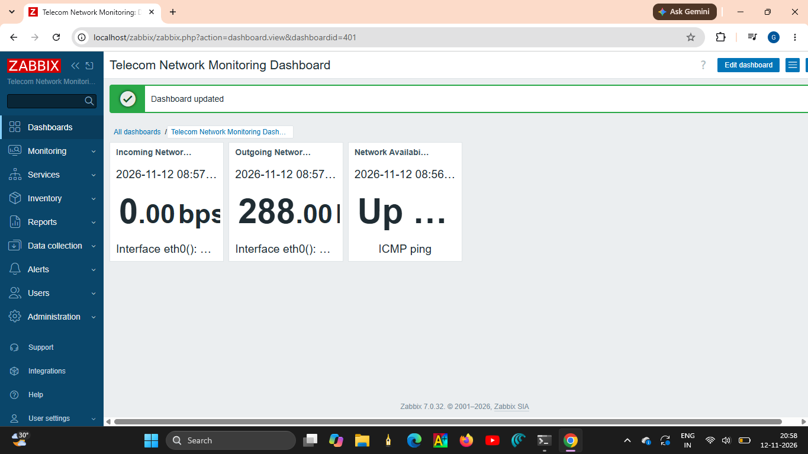
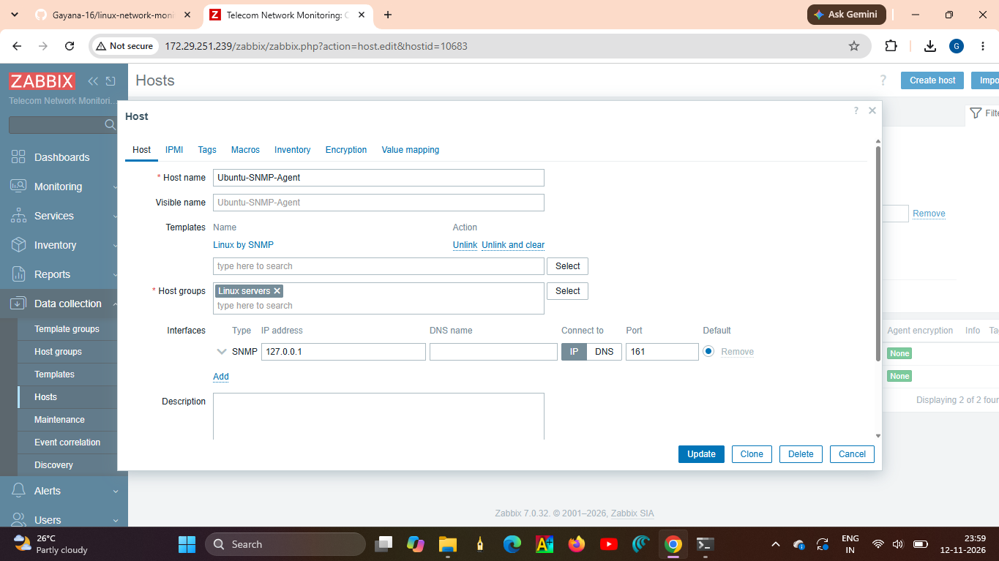
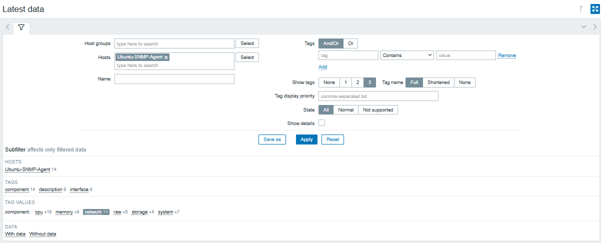
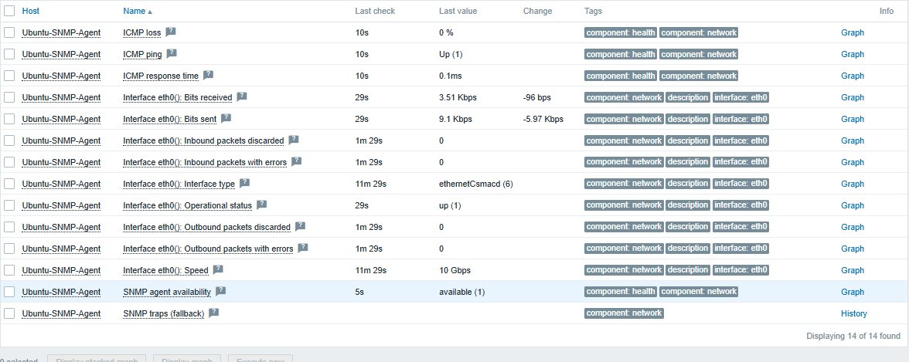

## 1. Project Overview

This project demonstrates Linux network monitoring and basic fault detection using SNMP and Zabbix.

A local Ubuntu environment running through WSL2 is configured as an SNMP-monitored host. Zabbix collects network interface information and monitors host availability through ICMP checks.

## 2. Objectives

- Configure an SNMP agent on Ubuntu.
- Connect the monitored host to the Zabbix server.
- Monitor incoming and outgoing network traffic.
- Monitor network interface status.
- Detect SNMP agent availability issues.
- Visualize monitoring information through a Zabbix dashboard.

## 3. Technologies Used

- Ubuntu 26.04 (WSL2)
- Zabbix 7.0
- Net-SNMP
- MariaDB
- Apache
- SNMPv2c
- ICMP

## 4. System Implementation

The monitoring environment consists of:

1. **Ubuntu:** Acts as the monitored Linux host.
2. **Net-SNMP Agent:** Provides network information through SNMP.
3. **Zabbix Server:** Collects and processes monitoring data.
4. **MariaDB:** Stores monitoring information.
5. **Zabbix Dashboard:** Displays network metrics and availability.

## 5. Monitoring Features

The following metrics were configured and monitored:

- Incoming network traffic.
- Outgoing network traffic.
- Network interface operational status.
- Interface errors and discards.
- Host availability using ICMP ping.
- ICMP response time and packet loss.

## 6. Fault Detection and Testing

An SNMP agent failure and recovery test was performed.

- Stopped the SNMP agent service.
- Observed the corresponding SNMP data collection problem in Zabbix.
- Restarted the SNMP agent.
- Verified that monitoring recovered.

This demonstrates basic service availability monitoring and fault detection.

## 7. Architecture

The repository includes two architecture diagrams:

- **Implementation Architecture:** Shows the actual local Ubuntu, SNMP and Zabbix monitoring setup.
- **Proposed Multi-City Network Topology:** Illustrates a conceptual network connecting Chennai, Coimbatore and Madurai through routers and switches.

**Note:** The multi-city topology is a proposed design and was not implemented or simulated as part of this project.

## 8. Project Limitations

- Monitoring was implemented on a local Ubuntu WSL2 environment.
- Only one local host was monitored.
- No physical routers or switches were connected.
- The multi-city network topology remains a proposed expansion.

## 9. Future Enhancements

- Simulate a multi-router network using Cisco Packet Tracer.
- Extend monitoring to multiple network devices.
- Explore SNMPv3 authentication and security.
- Configure additional network fault alerts.

## 10. Conclusion

This project provided practical experience in Linux administration, SNMP configuration, network monitoring, Zabbix dashboard creation and basic fault detection.
## Dashboard Screenshot

### 1. Zabbix Monitoring Dashboard

### 2. SNMP Host Configuration

### 3. Latest Data Filter

### 4. Network Monitoring Results

